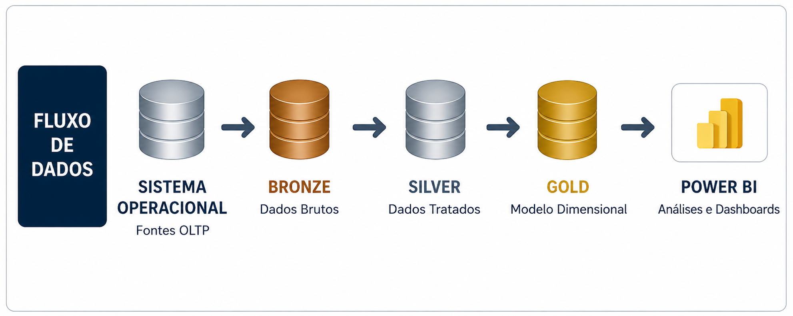
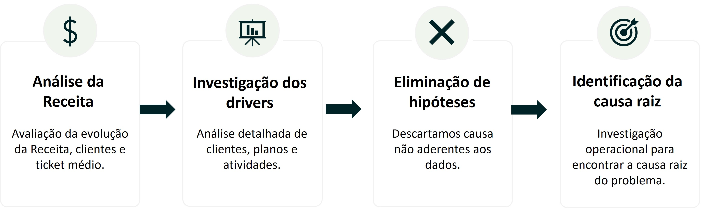
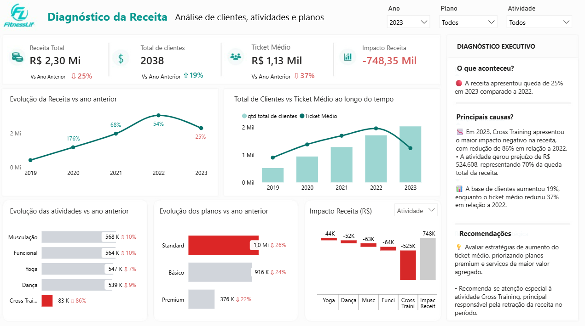

#  Projeto FitnessLife

Projeto completo de análise de dados com:

- SQL Server
- Data Warehouse
- Power BI
- DAX
- Business Analytics
- Storytelling com Dados

---
#  Visão Geral

O projeto foi desenvolvido de ponta a ponta, seguindo uma arquitetura moderna de dados em camadas Bronze, Silver e Gold, contemplando:

- ✅ Criação de Base de Dados
- ✅ Estruturação em Schemas
- ✅ Engenharia de Dados com SQL
- ✅ Tratamento e Qualidade de Dados
- ✅ Modelagem Analítica
- ✅ Views para consumo BI
- ✅ Dashboard Power BI
- ✅ Storytelling Executivo
- ✅ Identificação de Causa Raiz
---

#  Objetivo do Projeto

Identificar os fatores responsáveis pela queda de receita da academia em 2023, mesmo com crescimento da base de clientes.

---

#  Pergunta de Negócio

> Por que a receita caiu em 2023 apesar do aumento da quantidade de clientes?


---

#  Arquitetura do Projeto

O projeto foi estruturado utilizando arquitetura medalhão:



---

#  Estruturação do Problema

A investigação foi conduzida utilizando:




---

#  Principais Insights

| Indicador | Resultado |
|---|---|
| Receita | -25% vs 2022 |
| Clientes | +19% vs 2022 |
| Ticket Médio | -37% vs 2022 |
| Principal Driver | Cross Training - 86% vs 2022 |

---

#  Diagnóstico Executivo

A receita apresentou retração significativa devido à deterioração da monetização da base de clientes, impulsionada principalmente pela descontinuação da modalidade Cross Training em março de 2023.

A saída do professor responsável pela modalidade comprometeu:

- retenção de clientes
- percepção de valor
- receita premium
- ticket médio

---

#  Dashboard Power BI




---

#  Principais Descobertas

## 1️ Crescimento sem monetização

Apesar do crescimento da base de clientes de 19%, houve queda relevante de -37% do ticket médio.

## 2️ Queda distribuída entre os planos

Os planos apresentaram retração semelhante, descartando concentração do problema em um único plano.

## 3️ Cross Training concentrou as perdas

A modalidade foi responsável por aproximadamente 70% da queda total da receita, totalizando uma queda de R$-525 Mil. E o motivo foi a saída do professor desta modalidade em março de 2023. 


---

## 🧮 SQL em destaque

A camada Gold (`Scripts/05_views.sql`) transforma o modelo estrela em **views semânticas**, cada uma
respondendo a um ramo da Árvore de Problemas. O Power BI consome essas views diretamente.

| View | Pergunta de negócio | Técnicas |
|---|---|---|
| `vw_receita_anual` | Quando a receita caiu? | `JOIN`, `GROUP BY` |
| `vw_clientes_ativos` | Perdemos clientes? | `CROSS JOIN`, filtro por data, `DATEFROMPARTS` |
| `vw_ticket_medio` | O cliente passou a gastar menos? | `COUNT(DISTINCT)` |
| `vw_receita_plano` | Houve migração de plano? | `JOIN` com dimensão |
| `vw_receita_atividade` | **Qual atividade caiu?** (causa raiz) | `JOIN`, agregação |
| `vw_variacao_atividade` | Quanto cada atividade variou? | `CASE`, `NULLIF`, `ROUND` |

### 1. Clientes ativos no fim de cada ano

Um cliente conta como ativo se já estava cadastrado e **não tinha cancelado** em 31/12.
Isso evita contar quem saiu no meio do ano.

```sql
CREATE OR ALTER VIEW vw_clientes_ativos AS
SELECT
    d.ano,
    COUNT(*) AS clientes_ativos
FROM SILVER_cliente c
CROSS JOIN (SELECT DISTINCT ano FROM dim_data) d
WHERE c.data_cadastro <= DATEFROMPARTS(d.ano, 12, 31)
  AND (c.data_cancelamento IS NULL
       OR c.data_cancelamento > DATEFROMPARTS(d.ano, 12, 31))
GROUP BY d.ano;
```

### 2. Receita por atividade (a view da causa raiz)

```sql
CREATE OR ALTER VIEW vw_receita_atividade AS
SELECT
    b.ano,
    a.tipo_atividade,
    SUM(f.receita) AS receita_total
FROM fato_receita  f
JOIN dim_atividade a ON f.id_atividade = a.id_atividade
JOIN dim_data      b ON f.data         = b.data
GROUP BY b.ano, a.tipo_atividade;
```

Foi com ela que o problema se concentrou em **Cross Training** (~70% da queda total, cerca de R$ 525 mil).

### 3. Variação 2022 × 2023 por atividade

`NULLIF` evita divisão por zero em atividades que não existiam em 2022.

```sql
CREATE OR ALTER VIEW vw_variacao_atividade AS
SELECT
    b.tipo_atividade,
    SUM(CASE WHEN c.ano = 2022 THEN a.receita ELSE 0 END) AS receita_2022,
    SUM(CASE WHEN c.ano = 2023 THEN a.receita ELSE 0 END) AS receita_2023,
    SUM(CASE WHEN c.ano = 2023 THEN a.receita ELSE 0 END)
  - SUM(CASE WHEN c.ano = 2022 THEN a.receita ELSE 0 END) AS variacao_valor,
    ROUND(
        (SUM(CASE WHEN c.ano = 2023 THEN a.receita ELSE 0 END)
       - SUM(CASE WHEN c.ano = 2022 THEN a.receita ELSE 0 END)) * 100.0
       / NULLIF(SUM(CASE WHEN c.ano = 2022 THEN a.receita ELSE 0 END), 0), 2
    ) AS variacao_percentual
FROM fato_receita  a
JOIN dim_atividade b ON a.id_atividade = b.id_atividade
JOIN dim_data      c ON a.data         = c.data
GROUP BY b.tipo_atividade;
```

### Definições usadas
- **Clientes ativos:** cadastrados e não cancelados em 31/12 do ano.
- **Ticket médio:** receita do ano ÷ clientes distintos com receita no ano.

Os dois números podem diferir, porque nem todo cliente ativo gera receita no ano.

---

#  Estrutura do Repositório

```bash
FitnessLife
│── README.md
│
├── images/
│
├── PowerBI/
│   ├── README.md
│   └── FitnessLife_Dashboard.pbix
│
├── Scripts/
│   ├── README.md
│   ├── 01_init_database.sql
│   ├── 02_bronze.sql
│   ├── 03_silver.sql
│   ├── 04_gold.sql
│   └── 05_views.sql
│
├── Business Analytics/
│   ├── Apresentação_executiva.pdf

```

---


#  Documentações Técnicas

- [SQL & Data Engineering](https://github.com/VivianeAndrade1988/Projeto_Analise_Receita_FitnessLife/blob/main/Scripts/Readme.md)
- [Power BI & Analytics](https://github.com/VivianeAndrade1988/Projeto_Analise_Receita_FitnessLife/blob/main/Power_BI/Readme.md)

#  Apresentação executiva

Neste link tem toda a análise, desde o entendimento do problema, causa raiz, recomendações e próximos passos.


- [Business Analytics](https://github.com/VivianeAndrade1988/Projeto_Analise_Receita_FitnessLife/blob/main/Business_Analytics/Readme.md).

  

---

#  Competências Demonstradas

✅ SQL Server  
✅ Data Warehouse  
✅ Arquitetura Medalhão  
✅ ETL / ELT  
✅ Modelagem Dimensional  
✅ Star Schema  
✅ Power BI  
✅ DAX  
✅ Storytelling com Dados  
✅ Raciocinio analítico  
✅ Business Analytics  
